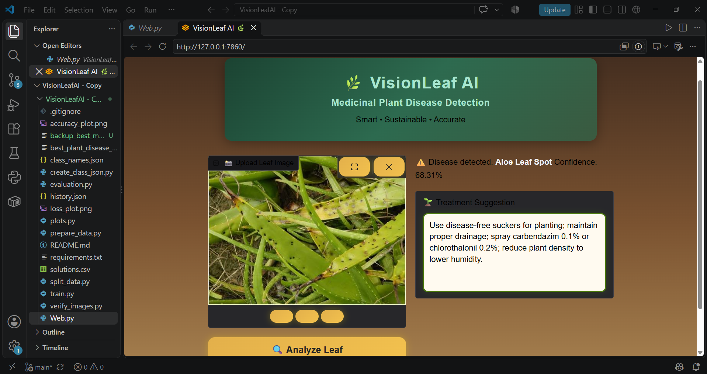
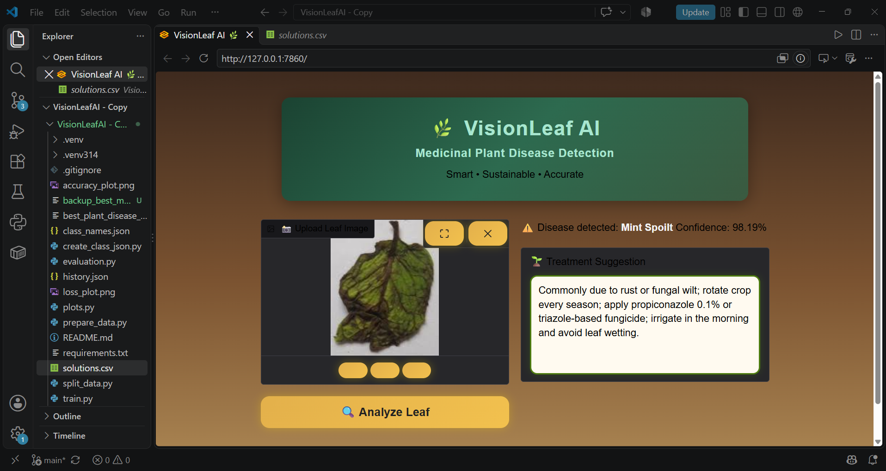

# VisionLeaf AI 🌿
### Medicinal Plant Disease Detection using Deep Learning

VisionLeaf AI is a computer-vision application that classifies medicinal plant leaf images into healthy or disease categories. It uses a fine-tuned **MobileNetV2** model and provides a treatment-information lookup for the predicted disease class.

The project covers **25 classes across 7 medicinal plants**: Aloe, Chrysanthemum, Hibiscus, Mint, Neem, Tulasi, and Turmeric.

## Highlights

- Upload a leaf image through a Gradio web interface.
- Classify the image using a trained MobileNetV2 model.
- Display the predicted class and model confidence.
- Show a corresponding information entry from `solutions.csv` for supported disease classes.
- Keep training history, loss curves, and validation-accuracy plots for model review.

## Model and reported result

| Item | Details |
|---|---|
| Architecture | MobileNetV2 (transfer learning / fine-tuning) |
| Number of classes | 25 |
| Plant categories | 7 |
| Input resolution | 224 × 224 |
| Reported test accuracy | **94.87%** |
| Inference framework | PyTorch / Torchvision |

The training script starts from ImageNet-pretrained MobileNetV2 weights, freezes the feature extractor initially, fine-tunes the final feature blocks, and replaces the classifier for the project's classes. The best validation checkpoint is saved as `best_plant_disease_model.pth`.

> **Evaluation note:** The 94.87% figure is the reported test-set accuracy for this project. Performance can vary with image quality, lighting, backgrounds, and samples that differ from the training data.

## Tech stack

- **Python**
- **PyTorch** and **Torchvision** — model training and inference
- **MobileNetV2** — image classification backbone
- **Gradio** — interactive web interface
- **Pandas** — treatment-information lookup
- **Pillow** — image handling
- **scikit-learn**, **Matplotlib**, and **tqdm** — evaluation, plots, and training utilities

## Repository structure

```text
VisionLeaf-AI/
├── Screenshot/
│   ├── Demo1.png
│   └── Demo2.png
├── Web.py                         # Gradio inference application
├── app.py                          # Earlier application version
├── train.py                        # Model training and fine-tuning
├── evaluation.py                   # Test-set evaluation
├── prepare_data.py                 # Dataset loading and transforms
├── split_data.py                   # Dataset splitting utility
├── verify_images.py                # Dataset image checks
├── create_class_json.py            # Class-label file utility
├── best_plant_disease_model.pth    # Trained model checkpoint
├── class_names.json                # Model output labels
├── solutions.csv                   # Disease-to-information lookup
├── history.json                    # Recorded training history
├── accuracy_plot.png               # Validation accuracy curve
├── loss_plot.png                   # Training/validation loss curves
├── requirements.txt
└── README.md
```

The training dataset is not included in this repository. The trained checkpoint and class-label file are included for inference.

## Getting started

### 1. Clone the repository

```bash
git clone https://github.com/jagadeesh-1818/VisionLeaf-AI.git
cd VisionLeaf-AI
```

### 2. Create and activate a virtual environment

**Windows PowerShell**
```powershell
python -m venv .venv
.\.venv\Scripts\Activate.ps1
```

**macOS / Linux**
```bash
python3 -m venv .venv
source .venv/bin/activate
```

### 3. Install dependencies

```bash
python -m pip install --upgrade pip
python -m pip install -r requirements.txt
```

For GPU-enabled training, install the PyTorch and Torchvision builds that match your CUDA environment using the official [PyTorch installation selector](https://pytorch.org/get-started/locally/). CPU inference is supported by the application.

### 4. Run the application

Run the Gradio app from the repository root:

```bash
python Web.py
```

Open the local URL printed in the terminal (typically `http://127.0.0.1:7860`).

## Screenshots

### Application interface and prediction


### Prediction and treatment information


## Training and evaluation

The training pipeline expects the dataset to be arranged in the directory structure used by `prepare_data.py`. The dataset itself is not tracked in this repository.

To train the model:

```bash
python train.py
```

To evaluate the saved checkpoint against the test split:

```bash
python evaluation.py
```

The evaluation script prints a classification report, confusion matrix, and overall test accuracy. Training history and plots are saved as `history.json`, `accuracy_plot.png`, and `loss_plot.png`.

## Important limitations

- Predictions are model estimates, not guaranteed diagnoses.
- Confidence is the model's softmax score and should not be interpreted as a calibrated probability.
- Treatment text is retrieved from a static CSV lookup; it is not generated or independently verified by the model.
- Verify plant disease identification and any treatment decision with a qualified agricultural or plant-health expert before acting.

## Author

**Jagadeesh B R**  
[GitHub profile](https://github.com/jagadeesh-1818)

---

If you find this project useful, feel free to star the repository.
